# 🧠 DocuMind: Enterprise Multi-Tenant Hybrid RAG Platform

DocuMind is an enterprise-grade document intelligence and Hybrid RAG (Retrieval-Augmented Generation) platform featuring **multi-tenant semantic caching**, **server-side dual-vector retrieval (Dense + BM25 RRF)**, **Cross-Encoder attention reranking**, **LangSmith `@traceable` observability**, **cross-provider cost tracking**, and **real-time SSE token streaming**.

---

## 🚀 Key Capabilities

- **Multi-Tenant Logical Isolation**: Strict tenant boundaries across PostgreSQL (relational foreign keys), Qdrant (`tenant_id` payload filters on both document chunks and semantic cache), and MinIO (tenant-partitioned object keys).
- **Layout- & Table-Aware Ingestion**: Parses PDFs, Markdown, and text files via LlamaParse OCR / PyPDF, then chunks with header-breadcrumb preservation and **table-header inheritance** (`split_markdown_table` in [`src/chunking/chunker.py`](src/chunking/chunker.py)) so split tables never lose column context.
- **Server-Side Dual-Vector Hybrid Retrieval**: Every chunk is indexed in Qdrant (`documind_hybrid_chunks`) with a **768-dim Dense vector** (`gemini-embedding-001`) and a **BM25 Sparse vector** (`Qdrant/bm25` via FastEmbed), fused server-side via **Reciprocal Rank Fusion (RRF)**.
- **Cross-Encoder Neural Reranking**: Uses `cross-encoder/ms-marco-MiniLM-L-6-v2` to score query–chunk pairs before generation.
- **Multi-Tenant Semantic Caching**: Dedicated Qdrant collection (`documind_semantic_cache`) serving exact and paraphrased queries at **$0.00 LLM cost** with strict `tenant_id` / `document_id` filtering and automatic invalidation on document deletion.
- **LangSmith `@traceable` Observability & Cost Tracking**: Native `@traceable` spans across cache lookup, hybrid retrieval, reranking, LLM streaming, and cache storage—paired with real-time token accounting and cost comparison across Gemini, OpenAI, and Anthropic models.
- **49-Cell 2D Evaluation Framework**: Automated benchmarking across **7 Document Categories × 7 Question Types** tracking `Recall@K`, `Precision@K`, `MRR`, `NDCG@K`, `Faithfulness`, `Answer Relevancy`, and `Refusal Accuracy`.
- **Full-Stack Streaming UI**: Built with **React 19**, **Vite**, and **Tailwind CSS**, featuring a tenant switcher, document uploader, SSE streaming progress stages, `⚡ Semantic Cache Hit` badges, and a Provenance Inspector.

---

## 🏗️ System Architecture

```mermaid
flowchart TD
    subgraph Ingestion Pipeline
        RawDoc["Uploaded Document (.pdf, .md, .txt)"] --> MinIO["MinIO S3 Storage"]
        MinIO --> Parser["DocumentParser (LlamaParse OCR / PyPDF)"]
        Parser --> Chunker["Markdown Chunker (Breadcrumbs & Table Header Inheritance)"]
        Chunker --> DualEmbed["Dual Embedder (Gemini Dense 768 + FastEmbed BM25)"]
        DualEmbed --> Qdrant[("Qdrant: documind_hybrid_chunks")]
        DualEmbed --> Postgres[("PostgreSQL: Metadata & Chunks")]
    end

    subgraph Traced RAG & Semantic Cache Pipeline
        Query["User Query"] --> SemCache{"Semantic Cache Lookup<br>(Qdrant Cosine >= 0.95)"}
        SemCache -- "HIT ($0.00 LLM Cost)" --> SSEStream["FastAPI SSE Stream (⚡ Cache Hit + Citations)"]
        SemCache -- "MISS" --> HybridQdrant["Qdrant Hybrid Search (Dense + BM25 RRF)"]
        HybridQdrant --> CrossEncoder["Cross-Encoder Reranker (Top K)"]
        CrossEncoder --> PromptBuilder["Context Assembly & Strict Source Citations"]
        PromptBuilder --> GeminiLLM["Gemini 3.1 Flash-Lite Stream"]
        GeminiLLM --> CostTracker["Cost Tracker (Token Usage & Model Comparison)"]
        CostTracker --> CacheStore["Populate Semantic Cache (Tenant Scoped)"]
        CacheStore --> SSEStream
        SSEStream --> AuditSave["Persist Provenance to PostgreSQL & Traces to LangSmith"]
    end
```



---

## 📂 Repository Structure

```text
documind/
├── src/
│   ├── api/
│   │   ├── routes/             # FastAPI endpoints (chat.py, documents.py, tenants.py)
│   │   └── schemas.py          # Pydantic request/response contracts
│   ├── chunking/chunker.py     # Breadcrumb & table-header-inheriting Markdown chunker
│   ├── db/                     # SQLModel entities & async PostgreSQL session
│   ├── parsing/parser.py       # LlamaParse OCR & PyPDF fallback parser
│   ├── search/vector_store.py  # Qdrant dual-vector store & @traceable hybrid RRF search
│   ├── services/
│   │   ├── chat_service.py     # End-to-end @traceable RAG pipeline & SSE streamer
│   │   ├── cost_tracker.py     # Token estimation & cross-provider cost comparison
│   │   ├── ingestion.py        # Async document ingestion orchestrator
│   │   └── semantic_cache.py   # Multi-tenant Qdrant semantic cache & invalidation
│   ├── storage/service.py      # MinIO / S3 & local blob storage provider
│   ├── config.py               # Pydantic settings & LangSmith env sync
│   └── main.py                 # FastAPI application entrypoint
├── evals/
│   ├── datasets/               # 49-cell golden evaluation dataset
│   ├── evaluators/             # Retrieval (Recall, Precision, MRR, NDCG) & LLM-as-a-Judge
│   ├── matrix.py               # 2D category × question-type matrix aggregator
│   ├── runner.py               # Evaluation suite runner with retry backoff
│   └── results/                # Latest Markdown scorecards & JSON reports
├── frontend/                   # React 19 + Vite + Tailwind CSS v4 web interface
├── notebooks/                  # Deep-dive notebooks on BM25, Hybrid RRF, & benchmarking
├── scripts/                    # CLI runners (run_evals.py, dataset/corpus tools)
├── tests/                      # E2E, semantic cache, table chunker, & tracing tests
├── PROJECT_REFERENCE.md        # Detailed status of completed work & future roadmap
├── decisions.md                # Architecture Decisions Record (ADR)
└── docker-compose.yml          # PostgreSQL 16, Qdrant v1.11.3, MinIO
```

---

## 🛠️ Quickstart Guide

### 1. Prerequisites
- **Python 3.12+**
- **Node.js v20+** & **npm**
- **Docker Desktop** (for PostgreSQL, Qdrant, MinIO)
- **Google Gemini API Key** ([Google AI Studio](https://aistudio.google.com/))
- *(Optional)* **LlamaParse API Key** ([LlamaCloud](https://cloud.llamaindex.ai/))
- *(Optional)* **LangSmith API Key** ([LangSmith](https://smith.langchain.com/))

### 2. Start Infrastructure
```powershell
docker compose up -d
```
Services started:
- **PostgreSQL 16**: `localhost:5433` (`documind_db`)
- **Qdrant Vector DB**: `localhost:6333` (REST/Dashboard) & `localhost:6334` (gRPC)
- **MinIO S3 Storage**: `localhost:9000` (API) & `localhost:9001` (Console)

### 3. Configure & Run Backend
```powershell
.\venv\Scripts\Activate.ps1
```
Ensure `.env` is configured (see `.env.example`):
```env
GEMINI_API_KEY=your-gemini-api-key-here
GEMINI_EMBEDDING_MODEL=gemini-embedding-001
GEMINI_CHAT_MODEL=gemini-3.1-flash-lite
DENSE_VECTOR_DIM=768

# Optional: Enable LangSmith Tracing
LANGCHAIN_TRACING_V2=false
LANGCHAIN_API_KEY=
LANGCHAIN_PROJECT=documind-rag
```
Start the FastAPI server:
```powershell
python -m uvicorn src.main:app --host 0.0.0.0 --port 8000 --reload
```
Swagger API Docs: [http://localhost:8000/docs](http://localhost:8000/docs)

### 4. Run Frontend
```powershell
cd frontend
npm install
npm run dev
```
Open [http://localhost:5173](http://localhost:5173).

---

## 🧪 Evaluation & Test Suites

```powershell
# 1. Run the 49-cell 2D RAG Evaluation Matrix
python scripts/run_evals.py

# 2. Test Multi-Tenant Semantic Caching (speedup, paraphrase hit, isolation, invalidation)
python tests/test_semantic_cache.py

# 3. Test LangSmith @traceable instrumentation & cross-provider cost comparison
python tests/test_langsmith_tracing.py

# 4. Test Table-Header Inheritance & E2E API/Chat flows
python tests/test_table_chunker.py
python tests/test_chat_e2e.py
python tests/test_api_e2e.py
```

**Latest 49-Cell Baseline Scorecard** ([`evals/results/latest_scorecard.md`](evals/results/latest_scorecard.md)):
- **Faithfulness**: `1.00` | **Answer Relevancy**: `0.95` | **Refusal Accuracy**: `0.80`
- **Recall@3**: `0.78` | **Precision@3**: `0.60` | **MRR**: `0.72` | **NDCG@3**: `0.72`
- **Composite Quality Score**: **`0.91`**

---

## 📚 Additional Documentation
- [**PROJECT_REFERENCE.md**](PROJECT_REFERENCE.md): Comprehensive breakdown of what is completed vs. what is planned on the roadmap.
- [**decisions.md**](decisions.md): Architecture Decisions Record (ADR).
- [**EMBEDDING_SIZE.MD**](EMBEDDING_SIZE.MD): Notes on embedding dimensionality trade-offs.
