# 🧠 DocuMind: Enterprise Multi-Tenant Hybrid RAG Platform

DocuMind is an enterprise-grade document intelligence and Hybrid RAG (Retrieval-Augmented Generation) platform featuring **server-side dual-vector retrieval (Dense + BM25 RRF)**, **Cross-Encoder attention reranking**, and **real-time token streaming** powered by Google Gemini.

---

## 🚀 Key Architectural Features

- **Multi-Tenant Logical Isolation**: Strict separation across PostgreSQL (relational foreign keys), Qdrant (`tenant_id` payload filters), and MinIO (tenant-partitioned storage keys).
- **Server-Side Dual-Vector Retrieval**: Every chunk is indexed with both a **768-dim Dense vector** (Gemini) and a **BM25 Sparse vector** (FastEmbed token frequencies). Merged directly inside Qdrant via server-side **Reciprocal Rank Fusion (RRF)** in compiled Rust memory.
- **Cross-Encoder Neural Reranking**: Uses `cross-encoder/ms-marco-MiniLM-L-6-v2` to compute deep token-level cross-attention, filtering out irrelevant chunks before prompting the LLM.
- **Grounded Streaming Generation**: Powered by **Google Gemini 3.1 Flash Lite** with real-time Server-Sent Events (SSE) streaming progress stages, citation badges (`[Source 1]`, `[Source 2]`), and token generation.
- **Full Provenance & Audit Trail**: Every answer saves exact chunk citations (point IDs, document IDs, page numbers, header breadcrumbs, RRF scores, and Cross-Encoder scores) to PostgreSQL JSON logs.
- **Modern Full-Stack UI**: Built with **React 19**, **Vite**, and **Tailwind CSS**, featuring a tenant switcher, drag-and-drop document uploader with live parsing indicators, and a split-screen Provenance Inspector.

---

## 🏗️ System Architecture

```mermaid
flowchart TD
    subgraph Ingestion Pipeline
        RawDoc["Uploaded Document (.pdf, .md, .txt)"] --> MinIO["MinIO S3 Storage"]
        MinIO --> Parser["DocumentParser (LlamaParse OCR / PyPDF)"]
        Parser --> Chunker["Markdown Chunker (Breadcrumbs & Tables)"]
        Chunker --> DualEmbed["Dual Embedder (Gemini Dense 768 + FastEmbed BM25)"]
        DualEmbed --> Qdrant[("Qdrant Hybrid Vector DB")]
        DualEmbed --> Postgres[("PostgreSQL Metadata & Chunks")]
    end

    subgraph Hybrid Retrieval & Chat Pipeline
        Query["User Query"] --> HybridQdrant["Qdrant Server-Side RRF Search (Top 15)"]
        HybridQdrant --> CrossEncoder["Cross-Encoder Reranker (Top 3-4)"]
        CrossEncoder --> PromptBuilder["Context Assembly & Strict Source Citations"]
        PromptBuilder --> GeminiLLM["Gemini 3.1 Flash Lite"]
        GeminiLLM --> SSEStream["FastAPI SSE Stream (Status + Citations + Tokens)"]
        SSEStream --> AuditSave["Persist Provenance to PostgreSQL"]
    end
```



---

## 🛠️ Quickstart Guide

### 1. Prerequisites
- **Python 3.12+**
- **Node.js v20+** & **npm**
- **Docker Desktop** (for PostgreSQL, Qdrant, MinIO)
- **Google Gemini API Key** (from [Google AI Studio](https://aistudio.google.com/))
- *(Optional)* **LlamaParse API Key** (from [LlamaCloud](https://cloud.llamaindex.ai/))

---

### 2. Start Infrastructure via Docker Compose

```powershell
docker compose up -d
```
This spins up:
- **PostgreSQL 16**: Port `5433` (`documind_db`)
- **Qdrant Vector DB**: Port `6333` (REST) & `6334` (gRPC)
- **MinIO S3 Object Storage**: Port `9000` (API) & `9001` (Console)

---

### 3. Backend Setup & Run

1. **Activate Python Virtual Environment**:
   ```powershell
   .\venv\Scripts\Activate.ps1
   ```
2. **Configure Environment Variables**:
   Ensure `.env` contains your Gemini API key:
   ```env
   GEMINI_API_KEY=your-gemini-api-key-here
   GEMINI_EMBEDDING_MODEL=gemini-embedding-001
   GEMINI_CHAT_MODEL=gemini-3.1-flash-lite
   DENSE_VECTOR_DIM=768
   ```
3. **Start the FastAPI Backend Server**:
   ```powershell
   python -m uvicorn src.main:app --host 0.0.0.0 --port 8000 --reload
   ```
   Interactive Swagger API Documentation: [http://localhost:8000/docs](http://localhost:8000/docs)

---

### 4. Frontend Setup & Run

In a new terminal window:
```powershell
cd frontend
npm install
npm run dev
```
Open your browser to: [**http://localhost:5173**](http://localhost:5173)

---

## 🧪 Automated Verification & Benchmarks

Run the end-to-end integration test suite:

```powershell
# Test Chat Service (Hybrid Retrieval + Reranking + Gemini Streaming + Audit Trail)
python tests/test_chat_e2e.py

# Test Full FastAPI REST API Pipeline (Upload + Ingestion + SSE Chat Stream)
python tests/test_api_e2e.py
```

### Educational Deep-Dive Notebooks
Located in `notebooks/`:
- `01_keyword_search_deep_dive.ipynb`: Mathematical foundation of BM25 (TF saturation, IDF, length normalization) and FastEmbed sparse vectors.
- `02_hybrid_search_and_reranking_deep_dive.ipynb`: Dual named vectors, Python RRF, Qdrant native server-side RRF, and Cross-Encoder rescoring.
- `03_retrieval_evaluation_benchmark.ipynb`: Automated benchmark evaluating Recall@K and MRR across ground-truth queries, demonstrating how Hybrid RRF + Reranker achieves 95.8% Recall@1 / 0.958 MRR.

---

## 📑 Architecture Decisions Record (ADR)
For deep-dive technical explanations and rationale on all architectural decisions, see [**decisions.md**](decisions.md).
