# DocuMind: Architecture Decision Records (ADR)

This document records the architectural, design, and technical decisions made during the design and implementation of **DocuMind**, an enterprise multi-tenant Hybrid RAG system.

---

## 1. Multi-Tenancy Isolation Strategy
- **Context**: Enterprise applications require strict logical isolation so one organization’s data can never be accessed or retrieved by another.
- **Decision**: Enforce multi-tenancy across all three infrastructure layers:
  1. **Relational Layer (PostgreSQL)**: Every entity (`Document`, `ChunkRecord`, `ChatSession`, `ChatMessage`) contains a mandatory foreign key indexed `tenant_id`. All queries strictly filter by `tenant_id`.
  2. **Vector Layer (Qdrant)**: Every point payload includes `tenant_id` indexed with a `KEYWORD` payload schema. Every Qdrant hybrid query enforces a `models.FieldCondition(key="tenant_id", match=models.MatchValue(value=tenant_id))` filter *before* HNSW graph traversal and sparse index lookup.
  3. **Object Storage Layer (MinIO / S3)**: Objects are partitioned by tenant prefix: `tenants/{tenant_id}/docs/{document_id}/{filename}`.
- **Consequences**: Zero cross-tenant data leakage, compliance-ready logical isolation, and predictable audit boundaries.

---

## 2. Relational ORM: SQLModel over Vanilla SQLAlchemy + Pydantic
- **Context**: Standard FastAPI projects often duplicate models: one set of classes for SQLAlchemy tables and a second parallel set of Pydantic models for request/response serialization.
- **Decision**: Adopt **SQLModel** (which unifies Pydantic v2 and SQLAlchemy 2.0).
- **Rationale**:
  - Single source of truth for database entities and API data contracts.
  - Full compatibility with SQLAlchemy async sessions (`asyncpg`) and connection pooling.
  - Native integration with FastAPI dependency injection (`get_db`).

---

## 3. Storage Layer: S3-Compatible Object Store (MinIO) with Community Silo
- **Context**: The official Docker Hub image `minio/minio` now enforces commercial license restrictions / pull rate limits.
- **Decision**: Deploy **`pgsty/silo:latest`** (a 100% S3-compatible open-source drop-in replacement) and abstract it behind [`StorageService`](src/storage/service.py) with presigned URL support and local filesystem fallback.
- **Infrastructure Port Remap**: Docker PostgreSQL was mapped to host port **`5433:5432`** to avoid collision with pre-existing Windows PostgreSQL instances running on port 5432.

---

## 4. Document Parsing: LlamaParse Cloud OCR with PyPDF Fallback
- **Context**: Real-world documents (PDFs, scans, contracts) contain complex layouts, multi-column text, and tabular data that traditional text extractors destroy into unreadable strings.
- **Decision**: Implement a two-tiered parsing pipeline in [`DocumentParser`](src/parsing/parser.py):
  1. **Primary**: **LlamaParse** multimodal cloud OCR. Detects tables and renders them into structured Markdown tables (`| col1 | col2 |`).
  2. **Fallback**: **PyPDF** local extraction. Activates automatically if running offline, in CI, or if no API key is supplied.
  3. **Direct**: Text decoder for native `.md`, `.txt`, `.csv` formats.

---

## 5. Chunking: Markdown Header Splitting with Context Breadcrumbs
- **Context**: Naive character chunking splits sentences arbitrarily and creates the "Lost Subject" problem (e.g., a chunk saying *"They receive 24/7 dedicated support"* loses context of *who* receives it).
- **Decision**: Build [`MarkdownChunker`](src/chunking/chunker.py) combining:
  1. `MarkdownHeaderTextSplitter` splitting on `#`, `##`, and `###` headers.
  2. **Context Breadcrumb Injection**: Prepending `[Context: Document Title > Section > Sub-section]` to every chunk's text.
  3. Paragraph and sentence boundary recursion via `RecursiveCharacterTextSplitter` for oversized sections.
  4. **Table Preservation**: Detecting and preserving Markdown tables intact without splitting rows across chunk boundaries (`has_table: True`).
- **Consequences**: Evaluated in our benchmark notebook to significantly increase semantic retrieval precision by anchoring every chunk with its hierarchical context.

---

## 6. Retrieval Engine: Server-Side Dual-Vector Hybrid Search (Dense + BM25 RRF)
- **Context**: Dense vector search excels at conceptual matching but fails on exact keywords (part numbers, IDs, legal acronyms). Keyword search (BM25) excels at exact tokens but fails on synonyms and paraphrasing.
- **Decision**: Implement **Dual Named Vectors** inside **Qdrant**:
  - Vector 1: `"dense"` (Cosine metric, Gemini embeddings).
  - Vector 2: `"sparse"` (Qdrant/BM25 token frequency inverted index via FastEmbed).
- **Why Server-Side Qdrant RRF instead of LangChain's `EnsembleRetriever`?**:
  - LangChain's `EnsembleRetriever` relies on an in-memory `BM25Retriever` (`rank_bm25`) stored in Python process memory. It cannot persist in a database, cannot sync across multi-worker FastAPI instances, and struggles with multi-tenant partitioning.
  - Qdrant executes **Server-Side Reciprocal Rank Fusion (RRF)** directly in compiled Rust memory via `models.Prefetch` and `FusionQuery(fusion=models.Fusion.RRF)`.
  - Atomicity: When a document is indexed or deleted, both dense and sparse vectors update simultaneously.

---

## 7. Dense Embeddings: Google Gemini with Matryoshka Representation Learning (MRL)
- **Context**: Google's `gemini-embedding-001` and `gemini-embedding-2` produce 3,072-dimensional vectors by default.
- **Decision**: Configure `config={"output_dimensionality": 768}` via Matryoshka Representation Learning (MRL), while keeping `DENSE_VECTOR_DIM` configurable in `src/config.py`.
- **Rationale**:
  - **Memory Footprint**: 768 dims reduces RAM usage in Qdrant by **75%** (12.3 KB vs 3.1 KB per vector).
  - **Latency**: Comparing 768-dim vectors fits within CPU SIMD registers (AVX-512/AVX2), providing **2.5x to 3.5x lower search latency** during HNSW traversal.
  - **Curse of Dimensionality**: In 3,072-dimensional space, distance concentration makes nearest neighbors less distinct; 768 dimensions sharpens cosine boundaries.
  - **MRL Performance Guarantee**: Google's Matryoshka training guarantees that the first 768 dimensions retain **~98.5% to 99%** of the full 3,072-dim retrieval accuracy.
- **Resilient Fallback**: [`DenseEmbeddingWrapper`](src/search/vector_store.py) dynamically falls back to local FastEmbed (`BAAI/bge-small-en-v1.5`) if running offline.

---

## 8. Multi-Stage Funnel: Cross-Encoder Reranking
- **Context**: Bi-encoder vector search (cosine distance and BM25) compares representations independently, which can rank superficial keyword overlap above deep conceptual answers.
- **Decision**: Build a two-stage retrieval funnel in [`ChatService`](src/services/chat_service.py):
  $$\text{Stage 1: Qdrant Hybrid RRF (Top 10-15 candidates)} \longrightarrow \text{Stage 2: Cross-Encoder Reranker (Top 3-4 chunks)}$$
- **Model**: `cross-encoder/ms-marco-MiniLM-L-6-v2` (fast 80MB CPU reranker) or `BAAI/bge-reranker-base`.
- **Validation**: In our empirical tests, Cross-Encoder assigned **`+6.71`** to the correct incident response section and **`-11.36`** to an unrelated system availability section, acting as an attention firewall against hallucination.

---

## 9. Generation & LLM: Google Gemini 3.1 Flash Lite via Direct `google-genai` SDK
- **Context**: We needed high-throughput, low-latency streaming generation and grounded citations.
- **Decision**: Use `gemini-3.1-flash-lite` via Google's official `google-genai` SDK.
- **Why Direct SDK over LangChain LCEL Chains?**:
  - Third-party wrapper packages often lag behind Google's fast-moving API versions (e.g. 404s on newest v1beta endpoints).
  - Native Python `AsyncGenerator` allows streaming structured events (`status`, `citations`, `token`, `done`) directly through FastAPI's `StreamingResponse` without complex callback handlers.
  - Direct, transparent error handling with 0 abstraction overhead.

---

## 10. Enterprise Provenance & Audit Trail
- **Context**: Regulated industries require tracking exactly why and how an AI generated a specific answer.
- **Decision**:
  1. **Strict Prompt Grounding**: System prompt forces explicit bracket citations (`[Source 1]`, `[Source 2]`) and forbids unsupported extrapolation.
  2. **Database Audit Log**: Every assistant response is saved to PostgreSQL `chat_messages` with a `retrieved_chunks` JSON column containing:
     - Qdrant `point_id`
     - Source `document_id`
     - Exact `page_number`
     - Section `header_path`
     - Raw text snippet
     - Qdrant `rrf_score`
     - Cross-Encoder `rerank_score`

---

## 11. API Design: Asynchronous Ingestion & Streaming SSE
- **Context**: Document parsing and OCR can take 5 to 30 seconds for large PDFs; holding an HTTP request open causes gateway timeouts.
- **Decision**:
  - `POST /api/v1/documents/upload`: Saves raw file to MinIO, creates `Document(status=PENDING)`, returns **202 Accepted** immediately, and dispatches processing via FastAPI `BackgroundTasks`.
  - `POST /api/v1/chat/stream`: Emits real-time Server-Sent Events (SSE) so users see live retrieval stages, citation badges, and streaming tokens as they generate.
  - Cascading deletion (`DELETE /api/v1/documents/{id}`): Atomically removes PostgreSQL records, wipes MinIO blobs, and purges Qdrant vectors.

---

## Architecture Summary Diagram

```mermaid
flowchart TD
    subgraph Ingestion Pipeline
        RawFile["Uploaded PDF / MD"] --> MinIO["MinIO S3 Storage"]
        MinIO --> Parser["DocumentParser (LlamaParse / PyPDF)"]
        Parser --> Chunker["Markdown Chunker (Breadcrumbs & Tables)"]
        Chunker --> DualEmbed["Dual Embedder (Gemini Dense 768 + FastEmbed BM25)"]
        DualEmbed --> Qdrant[("Qdrant Hybrid Vector DB")]
        DualEmbed --> Postgres[("PostgreSQL Metadata & Chunks")]
    end

    subgraph Retrieval & Chat Pipeline
        UserQuery["User Query"] --> HybridQdrant["Qdrant Hybrid RRF Search (Top 15)"]
        HybridQdrant --> CrossEncoder["Cross-Encoder Reranker (Top 3)"]
        CrossEncoder --> PromptBuilder["Prompt Grounding & Citation Injection"]
        PromptBuilder --> GeminiLLM["Gemini 3.1 Flash Lite"]
        GeminiLLM --> StreamSSE["FastAPI SSE Stream (Status + Citations + Tokens)"]
        StreamSSE --> AuditSave["Save Audit Trail to PostgreSQL"]
    end
```

